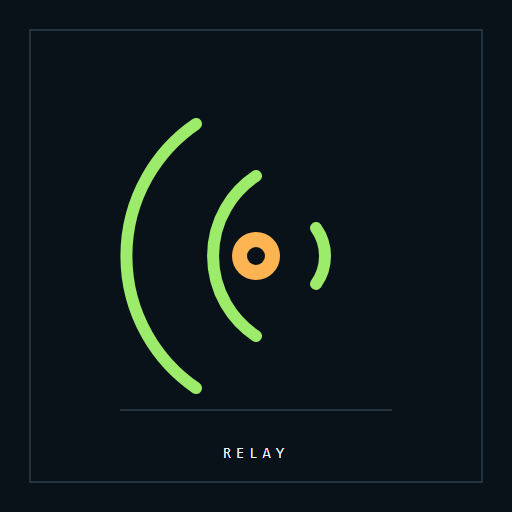
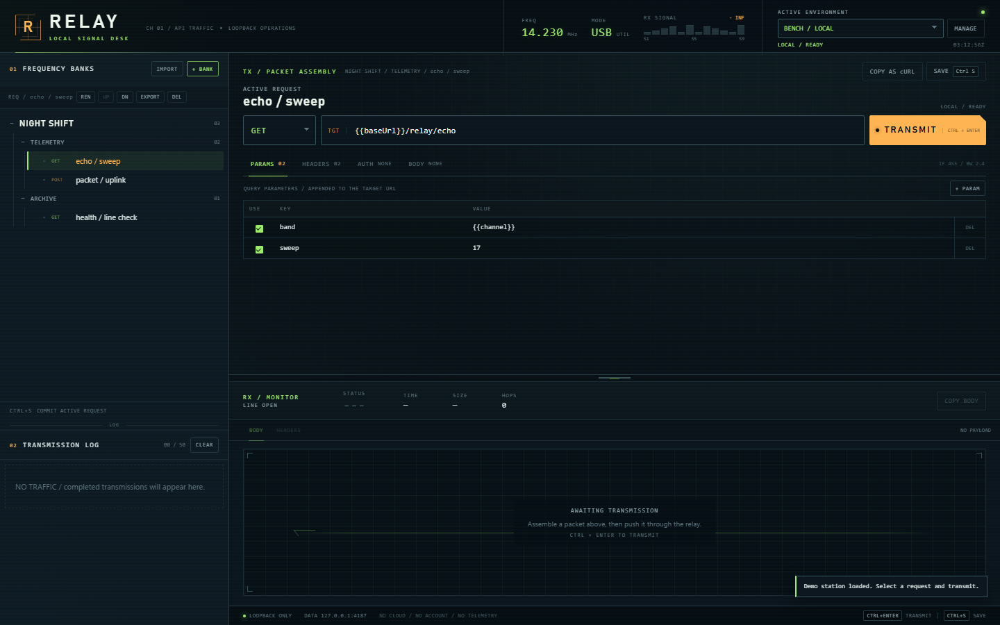
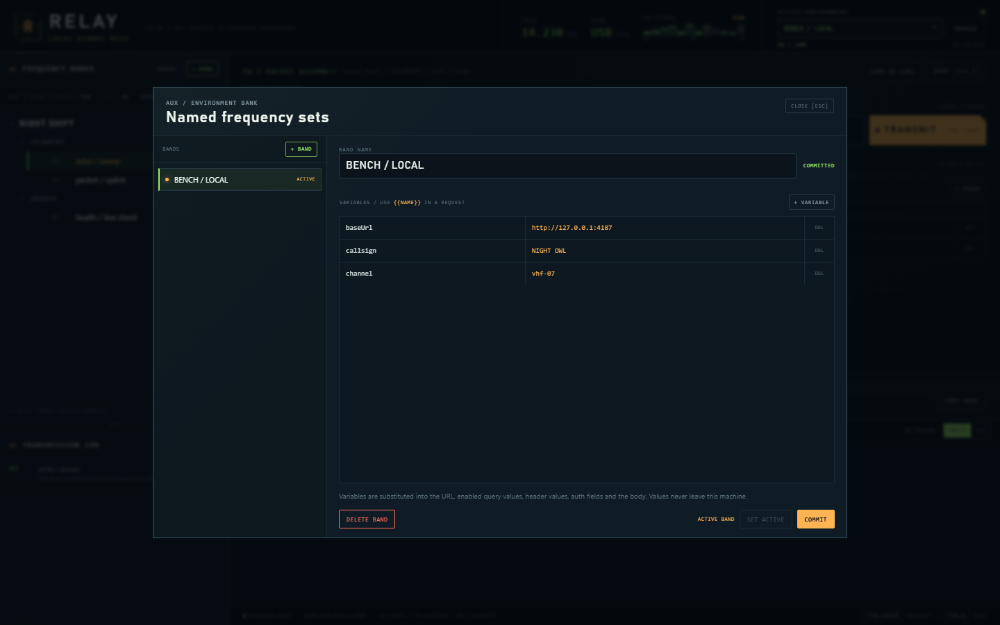
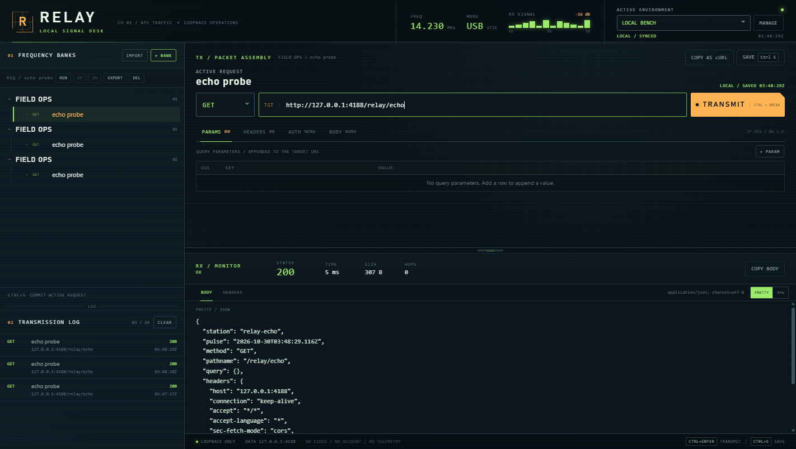
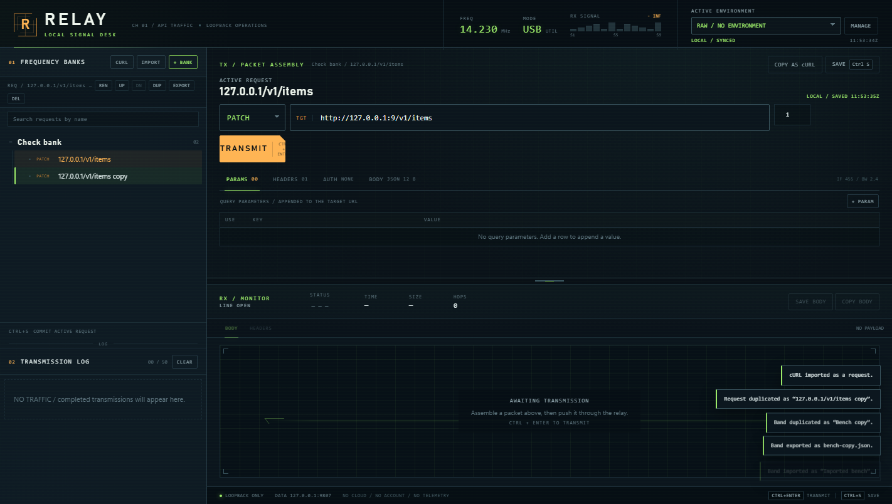
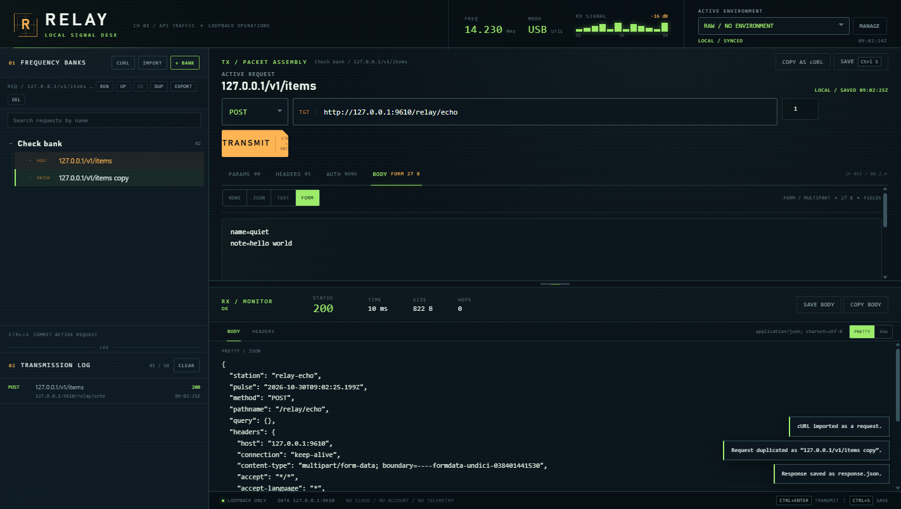

<div align="center">



# Relay

### Collections, environments and a transmission log — on your own machine.

A local API client with a loopback proxy, no account and no cloud sync.

[](https://github.com/KHHH2312/relay/releases/latest)
[](https://github.com/KHHH2312/relay/releases)
[](#requirements)
[](LICENSE)



</div>

> **New — 1.7.0** — duplicate an environment band with its variables.
> [Changelog →](CHANGELOG.md)

---

## Why Relay

**Cloud API clients want an account for data that never needed to leave the desk.**

**A local proxy avoids CORS without a browser extension or a remote relay.**

**A signal desk, not a form.** The request, the response and the history are one instrument.

## Features

| | |
|---|---|
| **Frequency banks** | Searchable collections, folders and requests with duplicate and move controls. |
| **Request builder** | Method, URL, per-request timeout, query, headers, auth, JSON/text or multipart form data. |
| **Environments** | Named variable sets, duplicated in one click, substituted through URL, headers, query and body. |
| **Loopback proxy** | CORS-free sends with timeout, redirect, size caps and metadata-host blocking. |
| **RX monitor** | Status, time, size, hops, headers, pretty/raw body and save-to-file. |
| **Transmission log** | The last 50 requests, persisted and clickable. |
| **Copy as cURL** | One click from a request to a reproducible command. |
| **Import cURL** | Paste a curl command; URL, method, headers, auth, bodies and -F fields import as a request. |
| **Form uploads** | FORM body with name=value fields and file attachments; multipart boundaries handled by the proxy. |
| **Import / export** | Collections as JSON; no lock-in. |

<div align="center">




</div>

## Requirements

- Windows 10 or 11, x64
- No account, no runtime install

## Install

1. Download **Relay-1.7.0-win32-x64.zip** from [Releases](https://github.com/KHHH2312/relay/releases/latest).
2. Verify it against `SHA256SUMS.txt`:
   ```powershell
   Get-FileHash .\Relay-*-win32-x64.zip -Algorithm SHA256
   ```
3. `FILEMANIFEST.txt` lists the SHA-256 and size of every file in the archive — diff it against what you unpacked.
4. Unzip anywhere and run **Relay.exe**.

> Self-signed development certificate: SmartScreen will warn until an OV/EV certificate is used.
> The SHA-256 checksum is the trust anchor.

## Using it

1. Install and launch Relay.
2. Create a bank (collection) and a request; set the URL, headers or body.
3. Create an environment, add variables and activate it.
4. Press Ctrl+Enter; inspect the response and reuse the entry from the transmission log.

## Verified

- Model/API suite: 79 checks green, including timeout bounds, a real echo server and multipart sends.
- Browser golden path: 18 checks green — import, duplicate, search, timeout, duplicate a band, send multipart, save.
- Packaged app passes the source-parity integrity gate and ships with SHA-256 sums and a per-file manifest.

## Security and privacy

- Local-first: the app runs on loopback, stores data on your machine and sends no telemetry.
- Strict renderer policy, sandboxed window, denied navigation/window-open by default.
- Releases are integrity-gated, signed and published with SHA-256 sums and a per-file manifest.
- Found a flaw? Open a private security advisory instead of a public issue.

## FAQ

**Does it need an account?** No.

**Where is my data?** In the app's local data folder, not on a server.

**Why is the source not in this repository?** This repository distributes the application and its
documentation. The source is private.

## License

MIT — see [LICENSE](LICENSE). Third-party components in [THIRD-PARTY.md](THIRD-PARTY.md).

---

## The rest of the desk

Five local-first tools, one philosophy: your files, your machine, no telemetry.

- **Pressroom** — [deck studio](https://github.com/KHHH2312/pressroom)
- **Folio** — [PDF bindery](https://github.com/KHHH2312/folio)
- **Relay** — [API client](https://github.com/KHHH2312/relay)
- **Slate** — [markdown notebook](https://github.com/KHHH2312/slate)
- **Boardroom** — [whiteboard](https://github.com/KHHH2312/boardroom)
